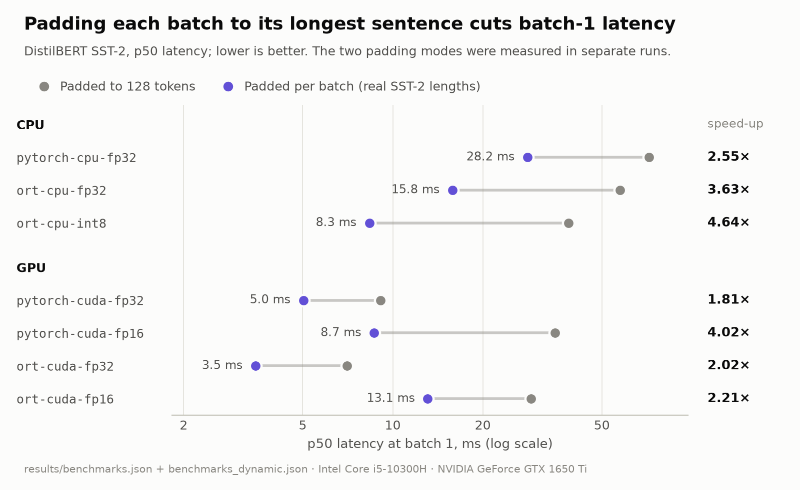
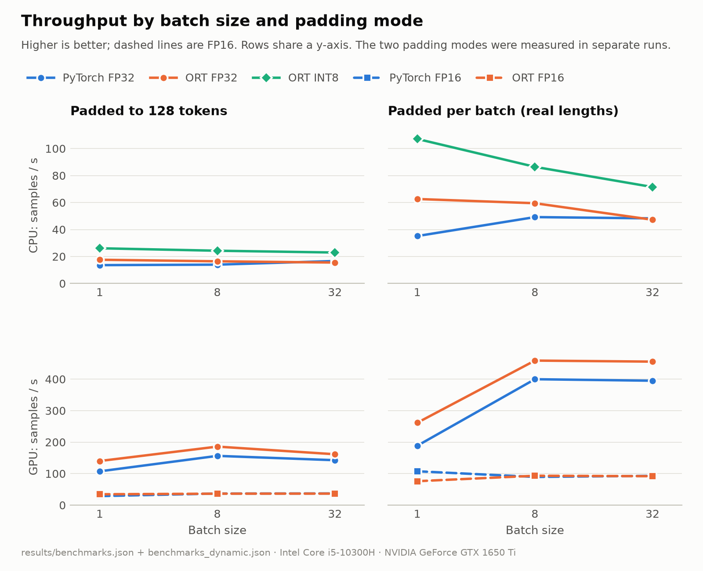
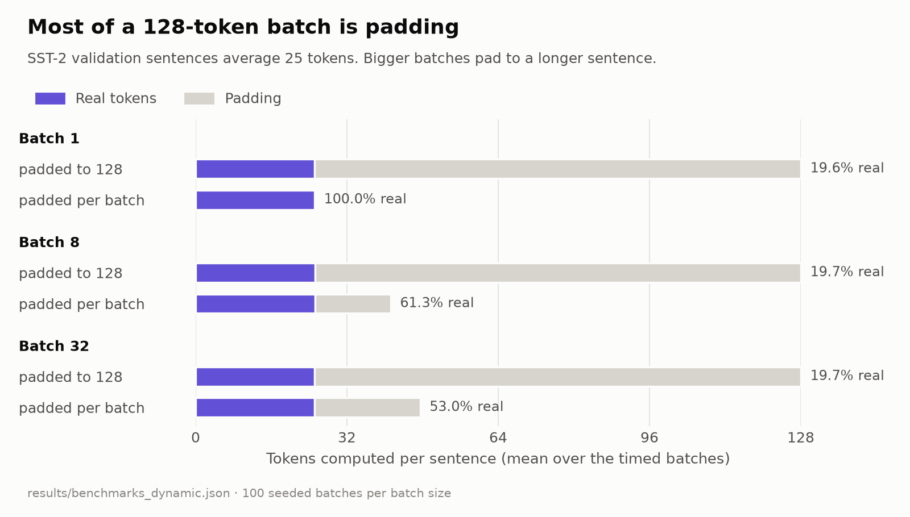
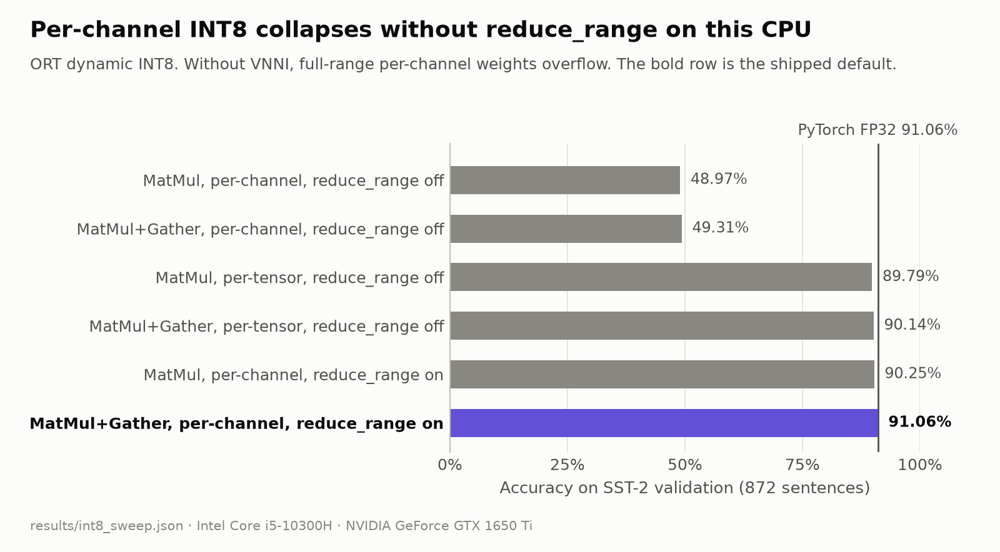

# Production Inference: DistilBERT Optimization & Benchmarking

An end-to-end, reproducible pipeline that takes
[`distilbert-base-uncased-finetuned-sst-2-english`](https://huggingface.co/distilbert/distilbert-base-uncased-finetuned-sst-2-english)
from a PyTorch baseline to optimized ONNX Runtime variants (FP32, FP16, INT8). It
measures the speed-vs-accuracy trade-off of each variant **on real hardware**. Every
number and chart below comes from the JSON files in `results/`, produced by this code on
the machine described.

| | |
|---|---|
| **Model** | DistilBERT (66M params), binary sentiment (SST-2), weights pinned to commit `714eb0f` |
| **Backends** | PyTorch (CPU/CUDA, FP32/FP16) and ONNX Runtime 1.26 (CPU EP, CUDA EP) |
| **Optimizations** | ONNX export (opset 17, dynamic axes), dynamic INT8 quantization, FP16 graph conversion |
| **Metrics** | p50/p95/p99 latency, throughput, peak RAM/VRAM, model size, SST-2 accuracy, F1, label agreement |

<picture>
  <source media="(prefers-color-scheme: dark)" srcset="docs/figures/latency_padding-dark.png">
  
</picture>

## Key findings

Unless a bullet says otherwise, numbers are p50 latency on fixed 128-token batches,
measured on the hardware below. Every variant was measured; none were skipped. The last
group of bullets uses real SST-2 sentence lengths (dynamic padding).

- **CPU: ONNX Runtime INT8 is the clear winner.**
  - **1.86× faster** than PyTorch FP32 at batch 1 (71.9 → 38.7 ms), 1.64× at batch 8 and
    1.37× at batch 32.
  - **3.96× smaller**: 255.6 → 64.5 MB.
  - About 1/3 of the extra RAM: 103 vs 304 MB at batch 1.
  - **No measured accuracy loss**: 91.06% SST-2 accuracy, F1 0.9135 vs 0.9137, and 98.4%
    of predictions identical to FP32.
- **CPU: ORT FP32 alone is a modest win.** It is 1.25× faster at batch 1, but PyTorch is
  slightly faster at batch 32 (0.93×). The two variants ran minutes apart on a laptop CPU,
  so treat an 8% gap as near parity rather than a ranking. PyTorch CPU also has the widest
  tail: at batch 8, p95 is 773 ms against a p50 of 540 ms.
- **GPU: ORT CUDA FP32 is the fastest variant overall.** It runs 1.30× faster than PyTorch
  CUDA FP32 at batch 1 (9.1 → 7.0 ms) and 1.13× faster at batch 32, reaching 186
  samples/s at batch 8. At batch 1 it is 10× faster than the PyTorch CPU baseline.
- **GPU: FP16 is 3.8–5.1× *slower* than FP32 on this GTX 1650 Ti**, for both PyTorch and
  ORT, and throughput caps at ~37 samples/s.
  - The profile shows why: cuBLAS runs FP16 GEMMs on Tensor-Core (`s884gemm`) kernels, and
    this GPU has no Tensor Cores. Those GEMMs take 4.7× as long as FP32's SGEMM kernels.
  - FP16 still halves VRAM (torch allocated 165 vs 294 MB) and the ORT model file
    (127.9 MB), with 100% label agreement. PyTorch FP16 casts the FP32 checkpoint at load,
    so its on-disk size stays 255.4 MB. Use FP16 here only when VRAM, not latency, is the
    constraint.
- **Accuracy holds everywhere.** All 7 variants score 91.06% on SST-2 validation, and every
  INT8/FP16 variant is within the configured tolerances.
- **Padding to the longest sentence in each batch instead of to 128 tokens is the largest
  single win.** SST-2 sentences average 25 tokens.
  - For the same variant and batch size, p50 latency drops **2.5–4.6× on CPU** and
    **1.8–2.8× on GPU** in FP32. These ratios compare against the fixed-padding run, which
    was a separate run.
  - At batch 1, ORT INT8 on CPU answers in **8.3 ms** (3.38× faster than PyTorch FP32's
    28.2 ms), and ORT CUDA FP32 in **3.5 ms**. ORT's lead over PyTorch grows on short
    inputs.
  - **Larger batches carry more padding.** The mean padded length grows from 25 tokens at
    batch 1 to 41 at batch 8 and 48 at batch 32. On CPU, throughput therefore *falls* with
    batch size: ORT INT8 does 107.1 samples/s at batch 1 and 71.5 at batch 32. On GPU,
    throughput levels off at batch 8 (ORT CUDA FP32: 459 vs 456 samples/s).
  - FP16 is still slower than FP32 on this GPU at every batch size (0.22–0.58×).
- **Recommendation for this machine:** ORT CUDA FP32 for GPU serving, and ORT INT8
  (per-channel + `reduce_range`) for CPU serving. Pad per batch, not to a fixed length. On
  CPU, keep batches small or group sentences of similar length.

---

## Reference hardware

| Component | Spec |
|---|---|
| CPU | Intel Core i5-10300H (Comet Lake, 4 cores / 8 threads, AVX2, **no VNNI**), 20 GB RAM |
| GPU | NVIDIA GeForce GTX 1650 Ti, 4 GB VRAM, Turing `sm_75`, **no Tensor Cores**, driver 591.59 |
| OS | Windows 11 + Git Bash, laptop on AC power |
| Stack | Python 3.12, torch 2.14.1+cu126, onnxruntime-gpu 1.26.0 (CUDA 12 / cuDNN 9), transformers 5.24 |

---

## Quickstart

Requires [uv](https://docs.astral.sh/uv/) and an NVIDIA driver supporting CUDA 12.x.
`make` is **not** required. Every task runs through `tasks.py` (stdlib only).

```bash
python tasks.py setup      # uv sync -> .venv with CUDA torch + onnxruntime-gpu
python tasks.py doctor     # verify torch CUDA build + a real ORT CUDA session
python tasks.py export     # FP32 ONNX (opset 17) + parity check on CPU and CUDA EPs
python tasks.py quantize   # INT8 (dynamic) + FP16 graphs, verified on all of SST-2 validation
python tasks.py benchmark  # all 7 variants, isolated workers; rewrites the tables below
python tasks.py benchmark-dynamic  # same on real SST-2 lengths (dynamic padding), ~10 min
python tasks.py figures    # redraw the README charts (docs/figures/) from results/*.json
python tasks.py profile    # torch.profiler Chrome trace + top-10 operators
python tasks.py all        # doctor -> export -> quantize -> benchmark(-dynamic) -> figures -> profile
```

Extra CLI flags go after `--`, e.g. `python tasks.py benchmark -- --variants ort-cpu-int8`.
A subset or quick run (`--variants`, `--iters`, `--batch-sizes`, `--skip-eval`, ...) writes
`results/benchmarks.partial.json` (or `benchmarks_dynamic.partial.json`) and leaves the
published results and README untouched. Only a complete default run updates them.
If you do have `make`, `make benchmark` and similar targets call the same tasks.

### CLI

| Command | What it does |
|---|---|
| `opt-pipeline env` | Checks the torch CUDA build and GPU arch, then opens a **real** ORT CUDA session |
| `opt-pipeline predict [TEXT...]` | Classifies sentences with the PyTorch baseline (`--device`, `--precision`) |
| `opt-pipeline export` | Exports ONNX (`--exporter torchscript\|dynamo`, `--opset`), then checks parity on CPU and CUDA |
| `opt-pipeline quantize` | Builds the INT8 and FP16 graphs and checks agreement with FP32 on SST-2 (`--skip-int8`, `--skip-fp16`) |
| `opt-pipeline benchmark` | Measures latency, throughput, memory, size and accuracy (`--padding max_length\|dynamic`, `--variants`, `--batch-sizes`, `--iters`, `--no-isolate`, `--update-readme`) |
| `opt-pipeline profile` | Runs `torch.profiler` and prints the top operators by self time (`--device`, `--precision`, `--batch-size`) |
| `opt-pipeline evaluate` | Reports SST-2 accuracy, F1 and label agreement per variant (in-process) |
| `opt-pipeline report` | Re-renders `results/*.md` and the README tables from each results JSON (`--input` for one file) |
| `opt-pipeline figures` | Draws the README charts from the results JSON as light and dark PNGs in `docs/figures/` (`--output-dir`). Needs matplotlib, a dev dependency |

Variants: `pytorch-cpu-fp32`, `ort-cpu-fp32`, `ort-cpu-int8`, `pytorch-cuda-fp32`,
`pytorch-cuda-fp16`, `ort-cuda-fp32`, `ort-cuda-fp16`.

---

## Results

Throughput for every variant, batch size and padding mode. The tables below add latency
percentiles, memory and accuracy. `python tasks.py figures` redraws every chart in this
README from the results files, so re-run it after a benchmark.

<picture>
  <source media="(prefers-color-scheme: dark)" srcset="docs/figures/throughput-dark.png">
  
</picture>

### Benchmarks

<!-- BENCHMARKS:START -->
_Generated 2026-11-25T08:09:32+00:00 from `results/benchmarks.json` (schema v1). CPU: Intel(R) Core(TM) i5-10300H CPU @ 2.50GHz (4C/8T, 19.8 GB RAM, on AC power). GPU: NVIDIA GeForce GTX 1650 Ti (4096 MB, driver 591.59). torch 2.14.1+cu126, onnxruntime 1.26.0. 100 timed iterations per cell, sequence length 128._

#### CPU latency & throughput

| Variant | Batch | p50 (ms) | p95 (ms) | p99 (ms) | Throughput (samples/s) | Speed-up vs PyTorch FP32 (p50) | Peak RAM Δ (MB) |
|---|---:|---:|---:|---:|---:|---:|---:|
| `pytorch-cpu-fp32` | 1 | 71.87 | 78.09 | 128.99 | 13.6 | 1.00× | 304 |
| `pytorch-cpu-fp32` | 8 | 540.36 | 772.51 | 821.42 | 14.0 | 1.00× | 353 |
| `pytorch-cpu-fp32` | 32 | 1910.81 | 2065.92 | 2147.36 | 16.7 | 1.00× | 500 |
| `ort-cpu-fp32` | 1 | 57.40 | 63.11 | 63.73 | 17.6 | 1.25× | 292 |
| `ort-cpu-fp32` | 8 | 486.89 | 515.77 | 533.69 | 16.4 | 1.11× | 334 |
| `ort-cpu-fp32` | 32 | 2065.43 | 2131.90 | 2203.03 | 15.5 | 0.93× | 489 |
| `ort-cpu-int8` | 1 | 38.68 | 40.76 | 42.54 | 26.1 | 1.86× | 103 |
| `ort-cpu-int8` | 8 | 329.19 | 344.24 | 352.45 | 24.3 | 1.64× | 141 |
| `ort-cpu-int8` | 32 | 1396.51 | 1475.96 | 1520.36 | 22.9 | 1.37× | 261 |

#### GPU latency & throughput

| Variant | Batch | p50 (ms) | p95 (ms) | p99 (ms) | Throughput (samples/s) | Speed-up vs PyTorch FP32 (p50) | VRAM device Δ (MB) | VRAM torch alloc / reserved (MB) |
|---|---:|---:|---:|---:|---:|---:|---: | ---:|
| `pytorch-cuda-fp32` | 1 | 9.11 | 10.35 | 10.89 | 107.3 | 1.00× | 368 | 294 / 326 |
| `pytorch-cuda-fp32` | 8 | 51.19 | 51.76 | 52.16 | 156.4 | 1.00× | 412 | 322 / 370 |
| `pytorch-cuda-fp32` | 32 | 224.53 | 225.46 | 226.05 | 142.6 | 1.00× | 532 | 421 / 490 |
| `pytorch-cuda-fp16` | 1 | 34.82 | 35.44 | 35.73 | 28.6 | 0.26× | 224 | 165 / 182 |
| `pytorch-cuda-fp16` | 8 | 217.38 | 217.89 | 218.26 | 36.8 | 0.24× | 244 | 181 / 202 |
| `pytorch-cuda-fp16` | 32 | 862.55 | 863.04 | 863.22 | 37.1 | 0.26× | 312 | 230 / 270 |
| `ort-cuda-fp32` | 1 | 7.02 | 7.82 | 7.98 | 140.0 | 1.30× | 590 | — |
| `ort-cuda-fp32` | 8 | 43.04 | 43.51 | 44.49 | 185.8 | 1.19× | 590 | — |
| `ort-cuda-fp32` | 32 | 198.19 | 199.39 | 199.56 | 161.5 | 1.13× | 590 | — |
| `ort-cuda-fp16` | 1 | 28.98 | 29.26 | 29.72 | 34.5 | 0.31× | 230 | — |
| `ort-cuda-fp16` | 8 | 220.11 | 220.40 | 221.04 | 36.3 | 0.23× | 358 | — |
| `ort-cuda-fp16` | 32 | 877.16 | 877.34 | 877.40 | 36.5 | 0.26× | 358 | — |

#### Accuracy & size (SST-2 validation)

| Variant | Provider | Model size (MB) | Accuracy | F1 | Δ accuracy vs PyTorch FP32 | Label agreement | Within tolerance |
|---|---|---:|---:|---:|---:|---:|:---:|
| `pytorch-cpu-fp32` | torch-cpu | 255.4 | 91.06% | 0.9137 | +0.00 pp | 100.00% | — |
| `ort-cpu-fp32` | CPUExecutionProvider | 255.6 | 91.06% | 0.9137 | +0.00 pp | 100.00% | — |
| `ort-cpu-int8` | CPUExecutionProvider | 64.5 | 91.06% | 0.9135 | +0.00 pp | 98.39% | ✅ |
| `pytorch-cuda-fp32` | torch-cuda | 255.4 | 91.06% | 0.9137 | +0.00 pp | 100.00% | — |
| `pytorch-cuda-fp16` | torch-cuda | 255.4 | 91.06% | 0.9137 | +0.00 pp | 100.00% | ✅ |
| `ort-cuda-fp32` | CUDAExecutionProvider | 255.6 | 91.06% | 0.9137 | +0.00 pp | 100.00% | — |
| `ort-cuda-fp16` | CUDAExecutionProvider | 127.9 | 91.06% | 0.9137 | +0.00 pp | 100.00% | ✅ |
<!-- BENCHMARKS:END -->

### Dynamic padding (real SST-2 lengths)

The tables above pad every batch to 128 tokens. SST-2 validation sentences average 25
tokens, and the longest is 55, so at fixed 128 about 80% of every batch is padding.
`python tasks.py benchmark-dynamic` times the same variants on real sentences. It draws
100 batches per batch size from the validation split, seeded so every variant gets the
same batches, and pads each batch only to its own longest sentence. Results go to
`results/benchmarks_dynamic.json`, and the published fixed-padding results stay as they
are.

<picture>
  <source media="(prefers-color-scheme: dark)" srcset="docs/figures/padding_tokens-dark.png">
  
</picture>

<!-- BENCHMARKS-DYNAMIC:START -->
_Generated 2026-11-25T09:25:58+00:00 from `results/benchmarks_dynamic.json` (schema v2). CPU: Intel(R) Core(TM) i5-10300H CPU @ 2.50GHz (4C/8T, 19.8 GB RAM, on AC power). GPU: NVIDIA GeForce GTX 1650 Ti (4096 MB, driver 591.59). torch 2.14.1+cu126, onnxruntime 1.26.0. 100 timed batches per cell, drawn (seed 42) from the validation sentences; each batch is padded to its longest sentence._

#### Workload (identical for every variant)

| Batch | Padded length: mean / p50 / max | Real tokens per sentence | Real share of padded tokens | Real share at fixed 128 |
|---:|---:|---:|---:|---:|
| 1 | 25.1 / 24 / 52 | 25.1 | 100.0% | 19.6% |
| 8 | 41.2 / 41 / 55 | 25.3 | 61.3% | 19.7% |
| 32 | 47.5 / 48 / 55 | 25.2 | 53.0% | 19.7% |

#### CPU latency & throughput (dynamic padding)

| Variant | Batch | p50 (ms) | p95 (ms) | p99 (ms) | Throughput (samples/s) | Speed-up vs PyTorch FP32 (p50) | Speed-up vs 128-token padding (p50) | Peak RAM Δ (MB) |
|---|---:|---:|---:|---:|---:|---:|---:|---:|
| `pytorch-cpu-fp32` | 1 | 28.19 | 33.93 | 37.94 | 35.1 | 1.00× | 2.55× | 293 |
| `pytorch-cpu-fp32` | 8 | 160.98 | 205.07 | 225.40 | 49.2 | 1.00× | 3.36× | 318 |
| `pytorch-cpu-fp32` | 32 | 655.72 | 817.22 | 857.44 | 48.2 | 1.00× | 2.91× | 387 |
| `ort-cpu-fp32` | 1 | 15.82 | 22.30 | 24.56 | 62.6 | 1.78× | 3.63× | 281 |
| `ort-cpu-fp32` | 8 | 132.93 | 179.27 | 187.02 | 59.5 | 1.21× | 3.66× | 307 |
| `ort-cpu-fp32` | 32 | 672.35 | 813.69 | 845.21 | 47.2 | 0.98× | 3.07× | 391 |
| `ort-cpu-int8` | 1 | 8.34 | 13.96 | 22.68 | 107.1 | 3.38× | 4.64× | 92 |
| `ort-cpu-int8` | 8 | 91.54 | 120.20 | 130.43 | 86.5 | 1.76× | 3.60× | 109 |
| `ort-cpu-int8` | 32 | 445.99 | 525.14 | 534.73 | 71.5 | 1.47× | 3.13× | 168 |

#### GPU latency & throughput (dynamic padding)

| Variant | Batch | p50 (ms) | p95 (ms) | p99 (ms) | Throughput (samples/s) | Speed-up vs PyTorch FP32 (p50) | Speed-up vs 128-token padding (p50) | VRAM device Δ (MB) |
|---|---:|---:|---:|---:|---:|---:|---:|---:|
| `pytorch-cuda-fp32` | 1 | 5.02 | 6.43 | 6.92 | 188.5 | 1.00× | 1.81× | 368 |
| `pytorch-cuda-fp32` | 8 | 20.42 | 22.22 | 22.41 | 399.7 | 1.00× | 2.51× | 372 |
| `pytorch-cuda-fp32` | 32 | 79.71 | 97.55 | 98.37 | 395.0 | 1.00× | 2.82× | 458 |
| `pytorch-cuda-fp16` | 1 | 8.66 | 13.69 | 14.11 | 107.4 | 0.58× | 4.02× | 222 |
| `pytorch-cuda-fp16` | 8 | 92.25 | 107.51 | 107.63 | 89.5 | 0.22× | 2.36× | 228 |
| `pytorch-cuda-fp16` | 32 | 332.84 | 397.49 | 397.65 | 93.0 | 0.24× | 2.59× | 264 |
| `ort-cuda-fp32` | 1 | 3.47 | 6.47 | 8.19 | 261.5 | 1.45× | 2.02× | 582 |
| `ort-cuda-fp32` | 8 | 16.84 | 23.44 | 23.72 | 458.9 | 1.21× | 2.56× | 582 |
| `ort-cuda-fp32` | 32 | 71.56 | 84.67 | 85.00 | 455.6 | 1.11× | 2.77× | 582 |
| `ort-cuda-fp16` | 1 | 13.09 | 14.97 | 15.33 | 75.9 | 0.38× | 2.21× | 324 |
| `ort-cuda-fp16` | 8 | 90.15 | 111.75 | 111.79 | 93.3 | 0.23× | 2.44× | 324 |
| `ort-cuda-fp16` | 32 | 346.64 | 381.51 | 386.97 | 91.8 | 0.23× | 2.53× | 326 |

The fixed-padding p50 comes from `results/benchmarks.json` (generated 2026-11-25T08:09:32+00:00), a separate run. The ratios therefore include drift between runs, which has reached about 8% on this laptop's CPU, so they are reliable for the multi-fold effects of padding but not for small differences.
Accuracy does not depend on the benchmark padding mode, because evaluation always pads dynamically. This run re-measured 91.06% for every variant.
<!-- BENCHMARKS-DYNAMIC:END -->

What the dynamic-padding run shows:

1. **Shorter inputs help the CPU most.** CPU latency falls 2.5–4.6×, roughly in line with
   the 2.7–5.1× fewer padded tokens per batch (128 divided by the mean padded length). On
   the GPU the gain is smaller at batch 1: 1.8× for PyTorch CUDA FP32 (9.1 → 5.0 ms),
   despite 5× fewer tokens. That is consistent with fixed per-call costs (kernel launches,
   host-device copies, Python dispatch) taking over once the GEMMs shrink. This is an
   inference, not a measurement: the profile above uses 128-token batches.
2. **ORT's advantage grows on short inputs.** At batch 1, ORT FP32 on CPU is 1.78× faster
   than PyTorch (1.25× at 128 tokens). ORT INT8 is 3.38× faster (1.86×), and ORT CUDA FP32
   1.45× (1.30×). A likely explanation is that each framework's fixed per-call overhead is a
   larger share of a shorter call. That hasn't been profiled.
3. **Batching stops paying.** Each batch is padded to its longest member, so larger
   batches carry more padding: 39% of every padded batch at batch 8 and 47% at batch 32.
   On CPU, the best throughput comes from batch 1 for both ORT variants and from batch 8
   for PyTorch. On the GPU, batch 8 and batch 32 give the same throughput. Grouping
   sentences of similar length before batching would recover most of that padding.
4. **Tails now include real length variation.** Every iteration has a different shape, so
   p95/p99 reflect long sentences as well as system jitter. ORT INT8 at batch 1 has a p50
   of 8.3 ms and a p99 of 22.7 ms. In the fixed-shape tables, the spread is jitter only.
5. **FP16 stays slower than FP32 on this GPU** at every batch size (0.22–0.58×). The gap
   narrows only for PyTorch at batch 1. This run didn't investigate FP16 further.
6. **Every variant ran identical work.** Each worker rebuilds the batches from the seed,
   and the results record a sha256 of every timed batch's token ids and mask. Validation
   rejects a results file whose variants don't share it.

### Methodology

Each number in the tables is measured as follows. The same description is stored in each
results file (`benchmarks.json`, `benchmarks_dynamic.json`) under `methodology`.

- **Isolation.** Each variant runs in a fresh subprocess. Peak RAM, the CUDA context,
  allocator caches and thread pools never carry over between variants. A failing variant is
  recorded as `error` with its log tail; it doesn't abort the run.
- **Timing boundary.** Host `int64` NumPy arrays go in and host `float32` logits come out,
  identically for every backend. PyTorch pays its host-to-device copy and device-to-host
  readback exactly as ONNX Runtime does. Tokenisation is excluded because it's identical
  for all variants. PyTorch CUDA iterations end with `torch.cuda.synchronize()`.
- **Shapes.** There are two padding modes.
  - *Fixed* (`benchmark`): one batch padded to `max_length = 128` tokens, repeated for every
    iteration. Every variant does exactly the same work. This is the worst case for SST-2,
    whose sentences average about 25 tokens.
  - *Dynamic* (`benchmark-dynamic`): 100 distinct batches per batch size, drawn from the
    SST-2 validation sentences with a fixed seed. Each batch is padded to its own longest
    sentence. Every worker rebuilds the same batches, and the results store a sha256 of
    them; validation fails if variants differ.
- **Warmup.** First an untimed shape pass: one iteration per distinct padded length,
  longest first, at least 3. For the fixed mode that is 3 iterations of the one shape; the
  dynamic mode has 18–35 shapes per batch size. The pass moves per-shape kernel selection
  and allocator-arena growth out of the timed loop. Then come 10 untimed warmup iterations
  and 100 timed iterations, with Python's garbage collector disabled. Seeds are fixed, and
  deterministic-algorithm mode is off for benchmarking.
- **Percentiles.** In the fixed mode, the p95/p99 spread is system jitter only. In the
  dynamic mode it also includes real variation in sentence length.
- **RAM.** Peak RSS, sampled every 2 ms during the *untimed* shape pass, minus RSS before
  the model was loaded. The sampler thread never runs alongside the timed loop. In the
  dynamic mode, the dataset is loaded before that baseline, so it isn't counted as model
  memory.
- **VRAM.** Two measurements, because they see different things:
  - *Device Δ*: `cudaMemGetInfo` used memory minus a baseline taken after the worker's CUDA
    context exists. It sees every runtime's allocations, so it is comparable across backends.
    It counts memory *reserved* by allocator pools. ONNX Runtime's CUDA arena grows in
    powers of two, which inflates its number relative to bytes actually used.
  - *torch alloc / reserved*: `torch.cuda.max_memory_allocated()` and
    `max_memory_reserved()`. These only exist for PyTorch variants, because ORT allocations
    are invisible to PyTorch's allocator, and they show `—` (never 0) for ORT.
- **Accuracy.** Measured on the full SST-2 validation split (872 sentences) with dynamic
  padding. *Label agreement* is the fraction of predictions identical to PyTorch FP32 on
  CPU. *Within tolerance* checks agreement and accuracy drop against `Tolerances` in
  `config.py`: INT8 needs ≥ 95% agreement and ≤ 2 pp drop; FP16 needs ≥ 99% and ≤ 0.5 pp.
- **Model size.** The on-disk size of the file each variant loads. PyTorch FP16 casts the
  FP32 checkpoint at load time, so its size equals FP32's.
- **Scope.** Dynamic INT8 is a CPU optimization in ONNX Runtime, so it is benchmarked on
  CPU only. The FP16 graph targets the CUDA EP; the CPU EP is an FP32 engine.

### ONNX export parity (PyTorch FP32 vs ONNX Runtime FP32)

Measured with `python tasks.py export`. The reference is PyTorch FP32 on CPU. Each EP runs
10 input shapes: batch sizes 1, 4 and 8, sequence lengths 3 to 128, covering padded,
unpadded and truncated inputs.

| ONNX Runtime EP | Opset | Shapes | Max abs logit diff | `np.allclose` (atol 1e-4, rtol 1e-3) | Label agreement |
|---|---|---|---|---|---|
| `CPUExecutionProvider` | 17 | 10 | 9.98e-06 | ✅ all | 100% |
| `CUDAExecutionProvider` | 17 | 10 | 4.35e-06 | ✅ all | 100% |

**Exporter.** `exporter = "torchscript"` (`dynamo=False`) is the default. It emits opset 17
and honours `dynamic_axes` natively. torch 2.14 marks it deprecated; `uv.lock` pins torch, so
it stays reproducible. `--exporter dynamo` uses the `torch.export`-based exporter instead:
it builds at opset 18 and down-converts to 17. Verified result: opset 17, parity max diff
1.5e-05 on CPU and 4.5e-06 on CUDA. Its progress output contains emoji, which crash Python's
cp1252 stdout on Windows. The pipeline therefore switches stdio to UTF-8 in-process (an
in-process `PYTHONUTF8=1`) and also sets `PYTHONUTF8=1` for every child process.
`export_onnx` raises if the written opset doesn't match the requested one.

### INT8 settings sweep

The INT8 defaults in `QuantizationConfig` come from a measured sweep, not from the
textbook recipe. Reproduce it with `uv run python scripts/int8_sweep.py`, which writes
`results/int8_sweep.json`. All rows are ORT dynamic quantization with QInt8 weights, scored
on all 872 SST-2 validation sentences. PyTorch FP32 scores 91.06% accuracy and 0.9137 F1.
Latency is a rough batch-8 p50 (20 iterations), a quick indicator rather than the benchmark
methodology.

| Quantized ops | Weight scales | `reduce_range` | Size (MB) | Accuracy | Drop | Agreement with FP32 | bs8 p50 (ms) |
|---|---|---|---:|---:|---:|---:|---:|
| MatMul | per-channel | off | 132.7 | **48.97%** | 42.1 pp | 47.1% | 391 |
| MatMul + Gather | per-channel | off | 64.5 | **49.31%** | 41.7 pp | 47.5% | 392 |
| MatMul | per-tensor | off | 132.5 | 89.79% | 1.26 pp | 97.8% | 385 |
| MatMul + Gather | per-tensor | off | 64.3 | 90.14% | 0.92 pp | 97.5% | 384 |
| MatMul | per-channel | on | 132.7 | 90.25% | 0.80 pp | 98.7% | 385 |
| **MatMul + Gather** | **per-channel** | **on** | **64.5** | **91.06%** | **0.00 pp** | **98.4%** | 392 |

(ORT FP32 measured the same way: 539 ms.)

<picture>
  <source media="(prefers-color-scheme: dark)" srcset="docs/figures/int8_sweep-dark.png">
  
</picture>

With per-channel weights at full 8-bit range, the model **collapses** to predicting one
class. This CPU has AVX2 but no VNNI. ORT's u8×s8 integer GEMM there accumulates pairwise
products in int16 (`vpmaddubsw`), which saturates when weights use the full s8 range.
Per-channel scaling pushes every channel to that range. `reduce_range=True` (7-bit weights)
removes the overflow. Quantizing `Gather` (the embedding table) halves the file again at no
measured cost. The zero accuracy drop is partly luck, since flips in both directions
cancel; the 98.4% label agreement is the more robust number.

`quant_pre_process` runs with `skip_symbolic_shape=True`. ORT's symbolic shape inference
cannot resolve the attention-mask subgraph that transformers 5 emits.

### Bottleneck profile

`python tasks.py profile` records 5 steady-state steps of the PyTorch baseline with
`torch.profiler` (batch 8 × 128 tokens, after warmup). It writes a Chrome trace (open it in
<https://ui.perfetto.dev>) and ranks **operators** and **CUDA kernels** separately by self
time. Rankings exclude the `ProfilerStep*` wrapper, so no time is counted twice. The output
lands in `artifacts/profiles/`.

**Top operators, as a share of each run's total (GPU kernel time on CUDA, self CPU time on CPU):**

| Operator | CUDA FP32 | CUDA FP16 | CPU FP32 |
|---|---:|---:|---:|
| `aten::addmm` (all linear layers: Q/K/V/O, FFN, classifier) | 223.6 ms (91.3%) | 1043.5 ms (97.7%) | 2247.4 ms (81.0%) |
| attention (`_efficient_attention_forward` / CPU flash SDPA) | 9.8 ms (4.0%) | 17.8 ms (1.7%) | 120.7 ms (4.3%) |
| `aten::gelu` | 4.4 ms (1.8%) | 2.2 ms (0.2%) | 119.2 ms (4.3%) |
| `aten::add` (residuals) | 3.5 ms (1.4%) | 1.9 ms (0.2%) | 62.6 ms (2.3%) |
| `aten::native_layer_norm` | 3.0 ms (1.2%) | 1.9 ms (0.2%) | 49.0 ms (1.8%) |
| `aten::copy_` | < 0.1 ms | < 0.1 ms | 135.6 ms (4.9%) |
| **Total** | **245.1 ms** | **1067.8 ms** | **2775.4 ms** |

**Top CUDA kernels:**

| Run | Kernels behind `aten::addmm` | GEMM time |
|---|---|---:|
| FP32 | `volta_sgemm_32x128_tn` (86.7 ms), `volta_sgemm_128x32_tn` (84.5), `volta_sgemm_128x128_tn` (52.3) | 223.5 ms |
| FP16 | `volta_fp16_s884gemm_fp16_128x128_ldg8_relu_f2f_tn` (348.6 ms), its `stages_32x1` variant (347.7), `cutlass_70_tensorop_f16_s884gemm` (346.9) | 1043.1 ms |

What the profile shows:

1. **The model is GEMM-bound on every device.** Linear layers take 81–98% of the time.
   Attention is at most 4%, so attention-specific optimizations such as fused attention or
   FlashAttention variants would gain little here. INT8 helps on CPU precisely because it
   attacks the GEMMs.
2. **Why FP16 is slower on this GPU.** For FP16, cuBLAS picks `s884` *tensor-op* (HMMA)
   GEMM kernels. Those are designed for Tensor Cores, and TU117 has none. On this card they
   take 4.7× as long as FP32's plain SGEMM kernels. Memory-bound element-wise ops benefit
   from FP16 as expected: GELU drops from 4.4 to 2.2 ms and LayerNorm from 3.0 to 1.9 ms.
   They are too small to matter. ORT's CUDA EP shows the same end-to-end slowdown, which
   fits it relying on the same cuBLAS FP16 GEMMs.
3. **On CPU, GEMMs dominate as well.** Most of the remaining time goes to `copy_`
   (layout/contiguity copies around attention), GELU and SDPA. ORT's graph fusions, which
   remove such glue ops, are a plausible source of its batch-1 advantage. INT8 GEMMs cut
   the dominant term.

Possible follow-ups, not yet measured:
- Force non-tensor-op FP16 GEMMs and check whether TU117's native 2:1 FP16 rate appears.
- Use ORT's fused transformer optimizer (`onnxruntime.transformers.optimizer`) as a
  separately labelled variant.
- Profile batch 1 at real SST-2 lengths to confirm where the time goes once the GEMMs
  shrink.
- Group sentences of similar length before batching (length bucketing). With dynamic
  padding, 47% of a batch-32 batch is still padding (see "Dynamic padding" above).

---

## Why the CUDA wheels are pinned

On Windows, PyPI's `torch` is a **CPU-only** build, and any `pip install`/`uv add` that
re-resolves torch can silently replace the CUDA build. `pyproject.toml` prevents this:

- `torch` is bound to the `https://download.pytorch.org/whl/cu126` index via
  `[tool.uv.sources]`, with `explicit = true` so no other package resolves from it.
- `onnxruntime-gpu` is capped at `<1.27`. **1.26.0 is the last PyPI release built for
  CUDA 12**; 1.27+ targets CUDA 13. It uses the CUDA 12 / cuDNN 9 DLLs bundled in the torch
  wheel, so no system-wide CUDA Toolkit or cuDNN install is needed.
- The CPU-only `onnxruntime` package is deliberately **not** a dependency. It installs the
  same `onnxruntime/` module and would shadow the GPU build.
- `create_ort_session` raises if the CUDA EP fails to load, instead of letting ORT silently
  fall back to CPU and mislabel CPU numbers as "GPU".

---

## Project layout

```
src/opt_pipeline/
  config.py              Frozen dataclass config (model + pinned revision, seq len, batch sizes,
                         warmup/iterations, exporter, tolerances, quantization, paths);
                         to_dict/from_dict round-trip for isolated workers
  errors.py              PipelineError hierarchy (CLI prints these cleanly; bugs keep tracebacks)
  utils.py               Logging, atomic writes (tmp + os.replace), UTF-8 stdio, file sizes
  baseline.py            PyTorch runner: deterministic seeding, CPU/CUDA, FP32/FP16, tokenisation
  export_onnx.py         ONNX export (torchscript | dynamo, opset 17, dynamic axes), ORT session
                         factory (no silent CPU fallback), PyTorch parity verification
  quantize.py            INT8 dynamic quantization, FP16 conversion, agreement vs FP32 reference
  runners.py             Variant registry + uniform host-to-host Runner over PyTorch / ORT
  evaluate.py            SST-2 loading, accuracy / F1 / label agreement
  benchmark.py           Fixed / dynamic-padding workloads, latency / throughput / memory
                         measurement, isolated workers, results schema, Markdown report
  profile_bottlenecks.py torch.profiler trace + top-N operators
  figures.py             README charts from the results JSON (matplotlib, light + dark PNGs)
  cli.py                 `opt-pipeline` CLI
tests/
  test_parity.py         Shapes, FP32 equivalence, dynamic seq len, INT8/FP16 tolerance,
                         CUDA EP, dynamo exporter
  test_benchmark.py      Latency/memory collection, workloads, JSON schema, comparisons,
                         report, config, CLI, LF output
  test_figures.py        Every chart renders from the tracked results, byte-identically
docs/figures/            Generated README charts (`python tasks.py figures`)
scripts/int8_sweep.py    Reproduces the INT8 settings sweep -> results/int8_sweep.json
tasks.py                 Cross-platform task runner (make replacement)
Makefile                 Thin wrapper around tasks.py
```

Generated and git-ignored: `.venv/`, `models/` (HF model cache), `data/` (processed SST-2
Arrow cache), and `artifacts/` (ONNX graphs, profiler traces, worker logs). The raw SST-2
parquet files (~3 MB) always go to the shared `~/.cache/huggingface/hub`; datasets 5.x
ignores `DownloadConfig.cache_dir` for Hub files. `results/` is tracked: `benchmarks.json`
and `benchmarks_dynamic.json` (each + `.md`), `evaluation.json` and `int8_sweep.json`. So
are the charts drawn from them in `docs/figures/`.

## Testing

```bash
python tasks.py test-fast   # 61 fast tests: metrics, workloads, schema, report, figures, config, CLI (~10 s)
python tasks.py test        # all 91: + export, INT8/FP16 parity, GPU, workers, profiler (~3 min)
python tasks.py check       # ruff + mypy --strict + full pytest
```

Slow tests are marked `slow`, and GPU tests are marked `gpu` and skip without CUDA. Tests
write only to pytest temp directories; they share the `models/` and `data/` caches but never
write to `artifacts/`, `results/` or `docs/`. The figure tests read the tracked `results/`
files as input.

---

## License

[MIT](LICENSE) © 2026 Omar Hazem
